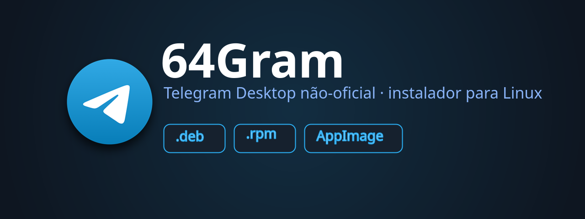
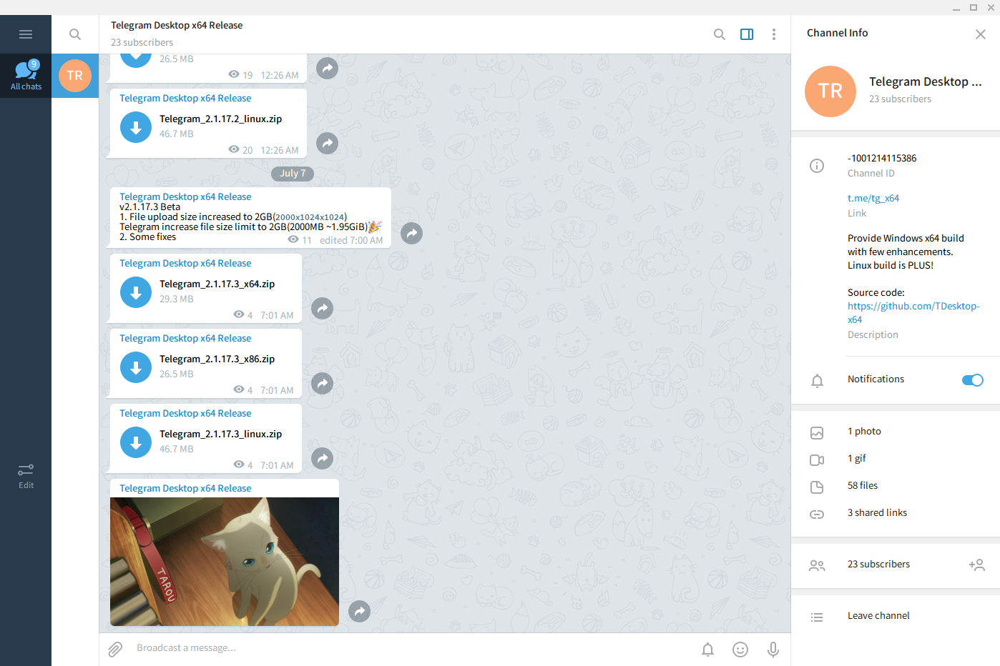

<div align="center">



[](https://github.com/LucianoSkx/64gram-installer/releases)
[](https://github.com/LucianoSkx/64gram-installer/releases)
[](https://github.com/LucianoSkx/64gram-installer/actions/workflows/packages.yml)
[](LICENSE)
[](#)

### 64Gram no Linux — sem compilar nada

Instalador de um comando + pacotes **`.deb`**, **`.rpm`** e **`.AppImage`** gerados
automaticamente pelo GitHub a cada release do
[64Gram](https://github.com/TDesktop-x64/tdesktop) (Telegram Desktop não-oficial).

</div>

---

## ⚡ Instalação

<table>
<tr>
<td width="33%" align="center"><b>🐧 Debian · Ubuntu · Mint</b></td>
<td width="33%" align="center"><b>🎩 Fedora · RHEL · openSUSE</b></td>
<td width="33%" align="center"><b>📦 Qualquer distro</b></td>
</tr>
<tr>
<td align="center">

```bash
sudo apt install ./64gram_*_amd64.deb
```

</td>
<td align="center">

```bash
sudo dnf install ./64gram-*.rpm
```

</td>
<td align="center">

```bash
chmod +x 64gram-*-x86_64.AppImage
./64gram-*-x86_64.AppImage
```

</td>
</tr>
</table>

<details open>
<summary><b>🔧 Um comando, em qualquer distro (script universal)</b></summary>

<br>

```bash
bash <(curl -fsSL https://raw.githubusercontent.com/LucianoSkx/64gram-installer/main/install.sh)
```

</details>

<details>
<summary><b>🐧 Arch · CachyOS · Manjaro</b></summary>

<br>

```bash
cd packaging && makepkg -si      # empacota como .pkg.tar.zst
paru -S 64gram-desktop-bin        # ou direto do AUR
```

</details>

---

## 🎬 Como fica

<div align="center">

</div>

---

## ✨ O que ele faz por você

|  |  |
|---|---|
| 📥 **Baixa e verifica** | pega o release oficial e confere o `sha256` antes de instalar |
| 🖥️ **Instala em dois modos** | sistema (`/opt/64gram`, precisa de root) ou só para você (`~/.local`) |
| 🧩 **Integra com o desktop** | ícones, menu, `tg://` e modo `--quit` |
| 🔄 **Atualiza e remove limpo** | `install.sh` de novo atualiza; `--uninstall` remove tudo |
| 💬 **Não mexe nas conversas** | o `tdata` em `~/.local/share/64Gram` continua intacto |
| 🤖 **Pacotes automáticos** | o GitHub gera `.deb`, `.rpm` e `.AppImage` a cada release novo |

**Opções**

```bash
./install.sh --user              # instala só para o usuário, sem root
./install.sh --version 1.2.10    # versão específica
./install.sh --local pacote.zip  # instala um zip já baixado (offline)
./install.sh --uninstall         # remove
```

---

## 🏗️ Estrutura

```
install.sh                       instalador universal (bash puro)
.github/workflows/packages.yml   CI: .deb + .rpm + .AppImage
packaging/nfpm.yaml              fonte única dos pacotes deb/rpm
packaging/appimage/build.sh      AppImage: AppDir + mksquashfs + runtime
packaging/build-packages.sh      build local dos três formatos
packaging/PKGBUILD               pacote Arch/CachyOS
```

<details>
<summary><b>Notas técnicas</b></summary>

<br>

- O release do 64Gram é um zip portátil (`Telegram` + `Updater`); o Qt6 já vai embutido
  no binário — as únicas dependências são glib2, pango, cairo, fontconfig, X11/xcb e
  dbus (checadas com `ldd`).
- O instalador escreve `externalupdater.d`, desligando o atualizador interno do app:
  quem atualiza é este script ou o seu gerenciador de pacotes.
- O CI consulta o release do upstream a cada 6h; se a tag `v<versão>` já existir aqui,
  não publica de novo.
- A AppImage é montada sem `appimagetool` (não precisa de FUSE no runner): `AppDir` +
  `mksquashfs` + runtime do AppImageKit.

</details>

<div align="center">
<sub>Projeto não-oficial · baseado no <a href="https://github.com/telegramdesktop/tdesktop">Telegram Desktop</a> · licença GPL-3.0</sub>
</div>
